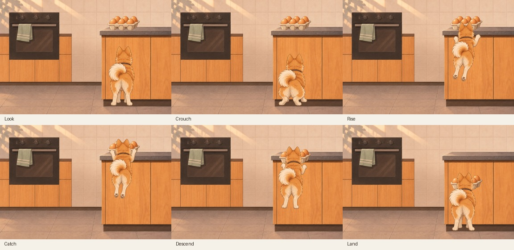

# Illustrated Ebi: approved art and one playable jump

Archived for PR #132 on 13 November 2026. Alan chose the clean illustrated A treatment, accepted the side-view motion proof, then approved the rear-view version: we only see Ebi's back, with the same kitchen and egg position. The playable test uses those exact rear-view poses and shared assets.

## Review locally

Open these self-contained HTML files directly in a browser. No install, server or API key is needed.

- [Playable rear-view jump](ebi-a-playable-20261112.html): Space, Jump or a click on the kitchen starts one jump and catch. The landing stays visible; Reset restores the starting scene. This is the latest interaction test.
- [Rear-view motion proof](ebi-a-rear-motion-proof-20261112.html): six poses with play, slow playback and a scrubber.
- [Side-view motion proof](ebi-a-motion-proof-20261112.html): the earlier feasibility study.
- [A/B illustration comparison](ebi-recognisable-comparison-20261112.html): A is the chosen direction; B is retained for comparison. These labels are separate from the older paper B and painted A experiments.



## Source and checks

The sibling dated folders retain the original generated PNGs, extracted transparent poses, kitchen and tray layers, exact prompts, provenance, motion samplers and builders. Historical provenance records retain their original workstation paths and validation status; they are snapshots, not runtime dependencies. The source paths under `artifacts/` now correspond to the same filenames in this archive.

From the repository root, rebuild the three motion/playable HTML files and run their checks:

```sh
python3 experiments/egg-heist/illustrated/ebi-a-motion-20261112/build.py
python3 experiments/egg-heist/illustrated/ebi-a-rear-motion-20261112/build.py
python3 experiments/egg-heist/illustrated/ebi-a-playable-20261112/build.py
node experiments/egg-heist/illustrated/ebi-a-motion-20261112/motion.cjs
node experiments/egg-heist/illustrated/ebi-a-rear-motion-20261112/motion.cjs
node experiments/egg-heist/illustrated/ebi-a-playable-20261112/check.cjs
```

Builders use Python's standard library; checks use Node's standard library. The playable check covers immediate input response, repeat protection, stable landing, keyboard and scene controls, mid-jump reset, long frames, reduced motion, asset-load failure and embedded assets. Desktop Chrome verified the catch, landed result and Reset on 12 November 2026. The disabled Jump button's text contrast was fixed; no design findings were suppressed or left open.

## Limits

Six held drawings still make pose changes visible. The test always catches the eggs; it has no challenge, scoring, audio or persistence. The art is accepted as a visual target, while responsiveness and repeat-play appeal still need Alan's feedback. Real-phone testing, in-between drawings and site integration remain undone. This archive changes no routes, production imports or dependencies.
