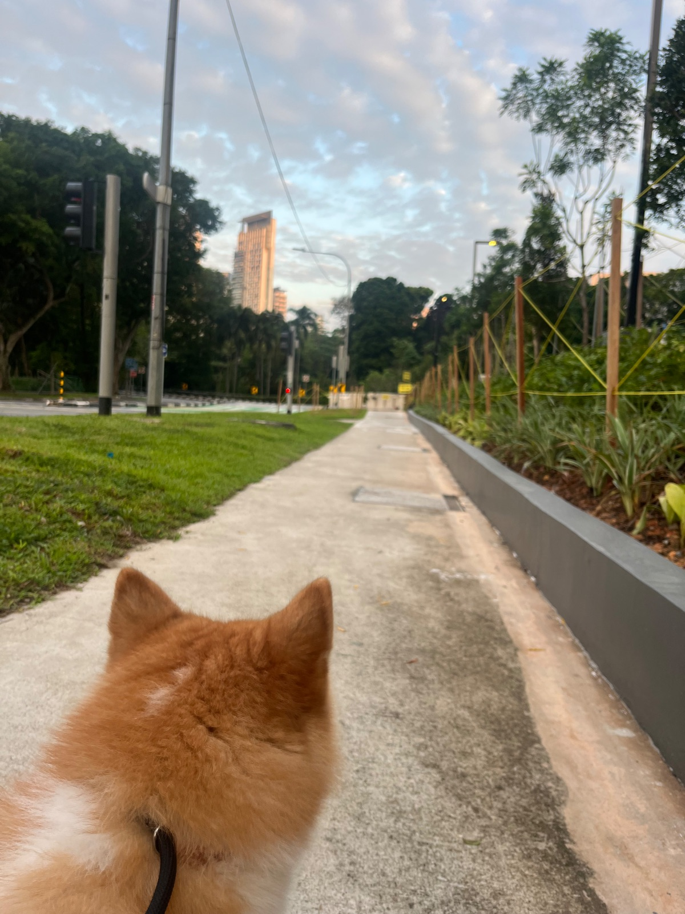
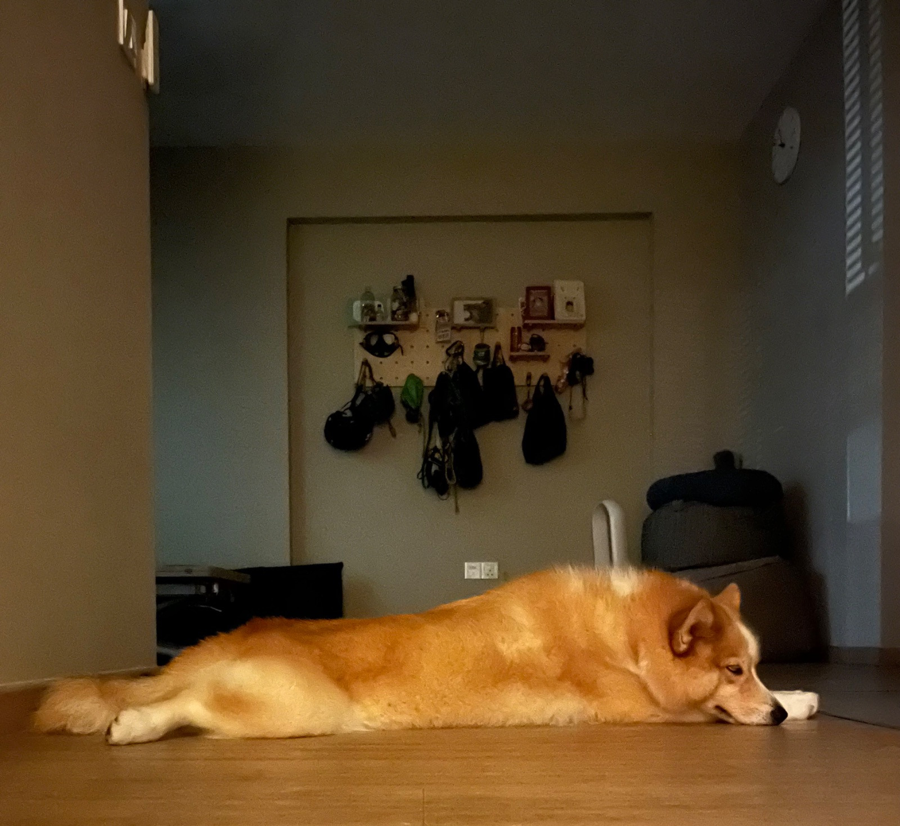
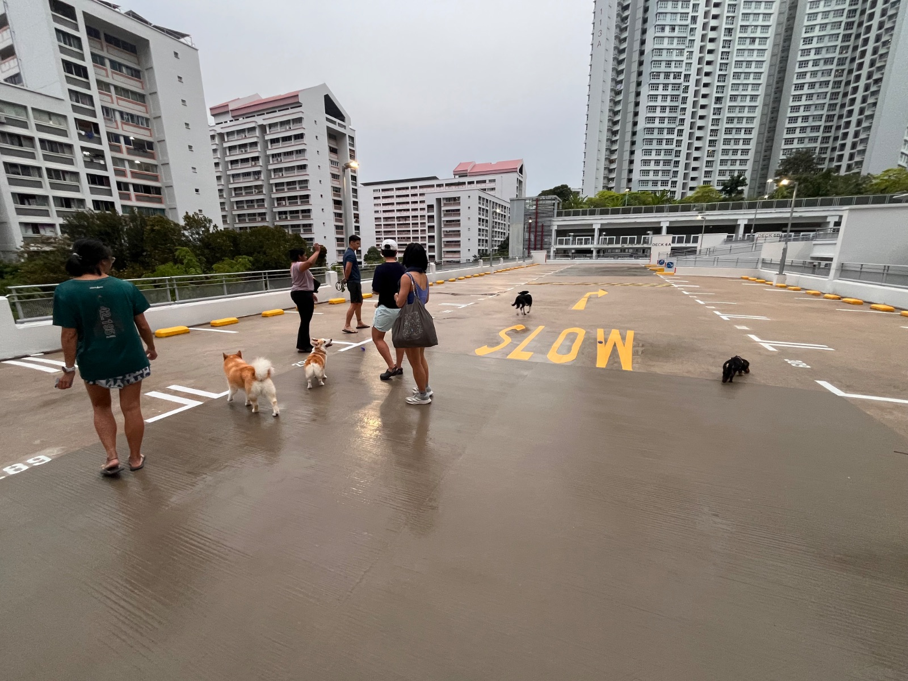
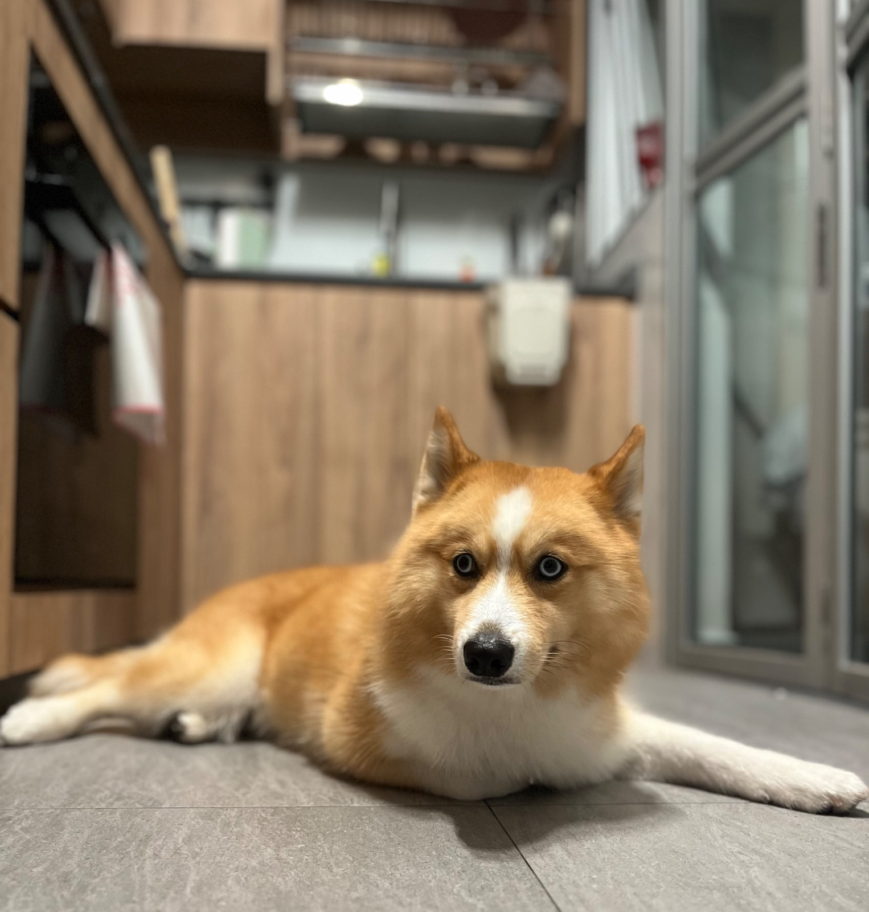
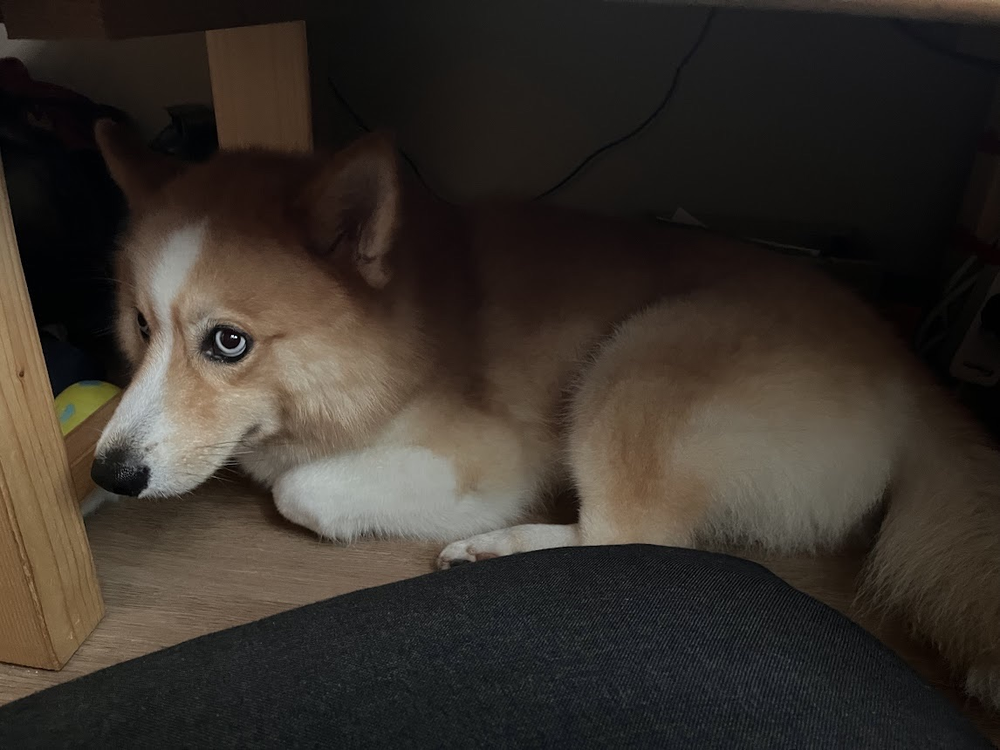
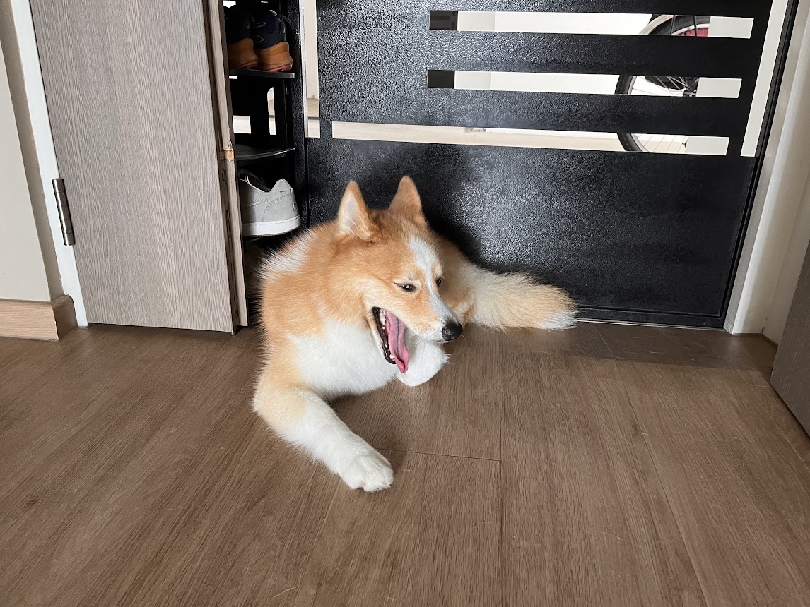
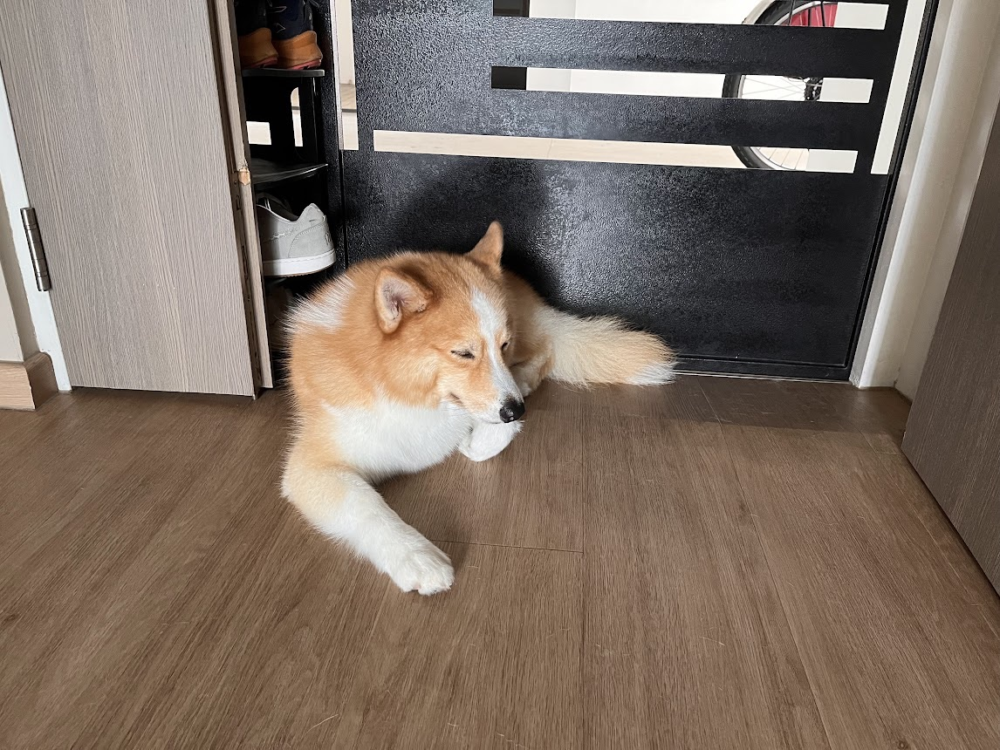
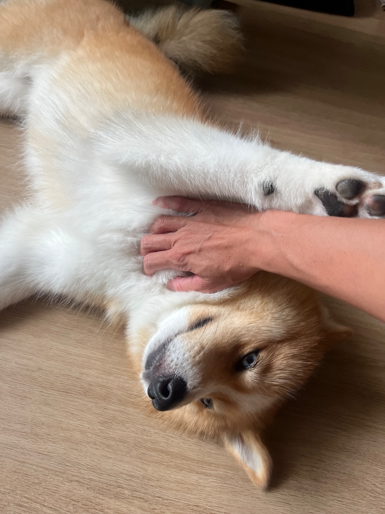
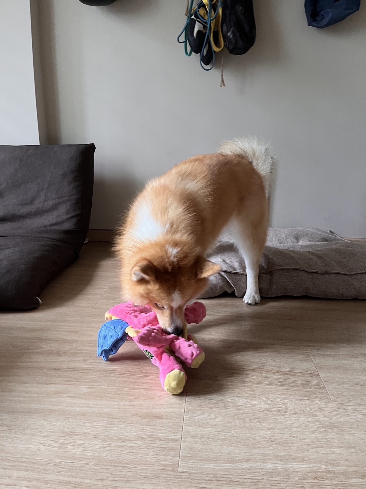

## 7 Nov

### 6:35am

<!-- entry-id: e184 -->

“I’m awake, so no one should be sleeping,” says Ebi. Here we are on a long walk to buy the hoomans’ breakfast.

## 6 Nov

### 9:45pm

<!-- entry-id: e183 -->

Obstacle course.

### 6:30pm

<!-- entry-id: e182 -->

Manja Ebi’s commercial break to play some ball.

### 6:15pm

<!-- entry-id: e181 -->

Everyone noticed Ebi was more manja than usual today, going to every human in rotation for pats at the car park. She must be missing her parents.

### 3:56pm

<!-- entry-id: e179 -->

“I’m going to be first when the donut comes out of the oven, guarding it with my life,” Ebi says.

### 2:51pm

<!-- entry-id: e178 -->
<!-- no-time -->

Back to her usual cave under Alan's desk. Neighbourhood watch is on hold.

### 1:58pm

<!-- entry-id: e176 -->
<!-- no-time -->

Barking at every movement outside. Neighbourhood watch is tiring work.

### 1:55pm

<!-- entry-id: e177 -->
<!-- no-time -->

Alan the snake charmer, with a plate for a flute and Ebi under his spell.

### 11:45am

<!-- entry-id: e175 -->

Collecting scratch tax from the humans.

### 11:43am

<!-- entry-id: e007 -->
<!-- no-time -->

Ebi defeating Tiny's pink dragon. One less opponent to compete with for snacks.

## 12 Sep

### 6:25pm

<!-- entry-id: e001 -->

Left with her daddy. Started whining and barking the moment dinner time rolled round, right on cue, like she had a clock in her head, acting like she hadn't eaten the whole day.

### 5:20pm

<!-- entry-id: e002 -->

Went out for a short walk. Everything on the ground looked like a snack to her. We made sure none of it was.

### 4:50pm

<!-- entry-id: e003 -->

Woke up. Barked and whined like the world owed her a play session.

### 3:50pm

<!-- entry-id: e004 -->

Finally lost the fight to stay awake. Out cold on the floor.

### 2:45pm

<!-- entry-id: e005 -->

Licked dragonfruit, egg and cucumber off the Kong tyre with total focus. Squeaky toy, ball, nothing could pull her attention away.

### 2pm

<!-- entry-id: e006 -->

Charged in like a battering ram. Humans didn't even have a chance to remove her leash.
