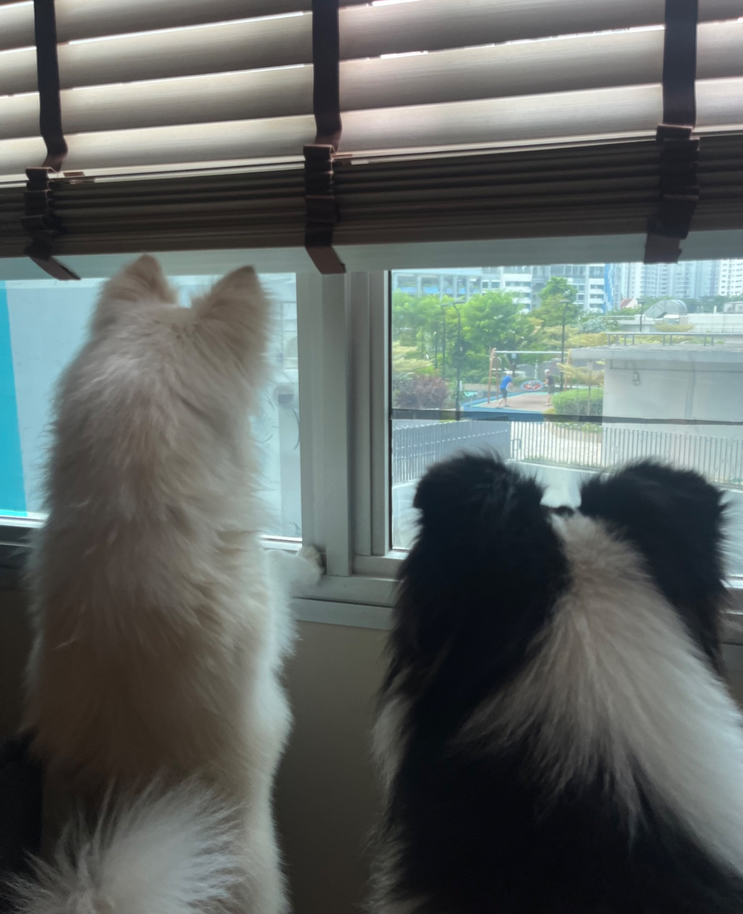
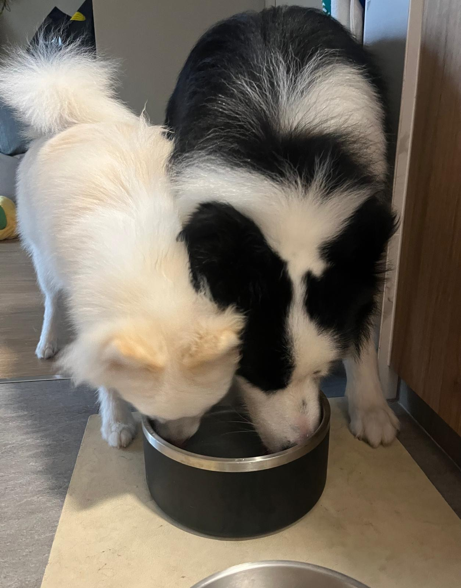
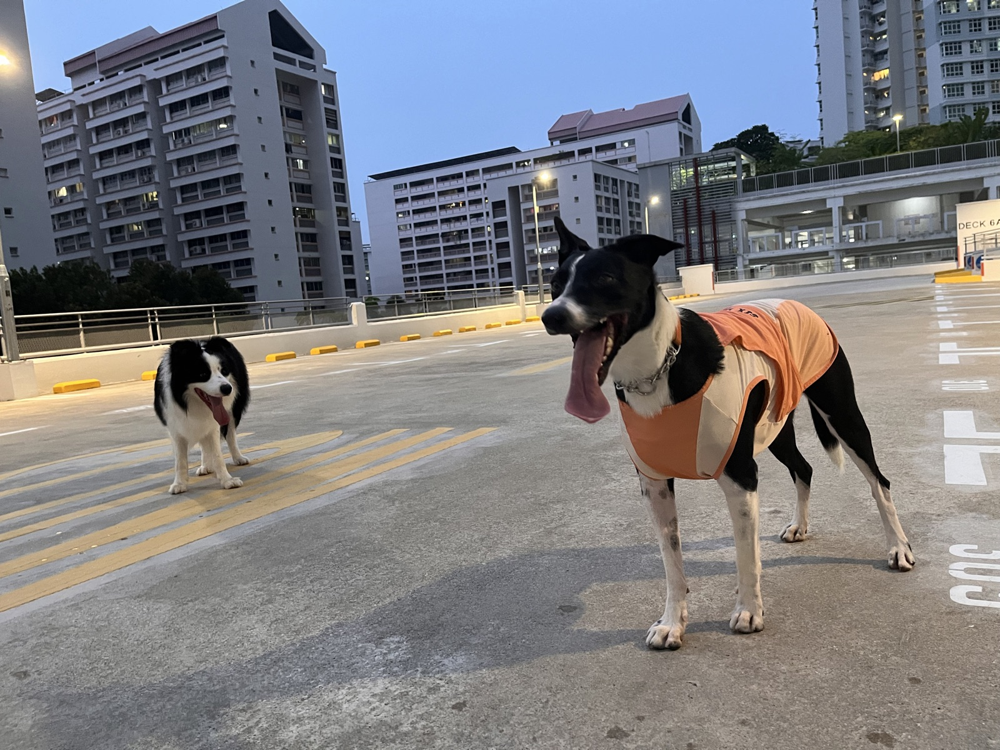
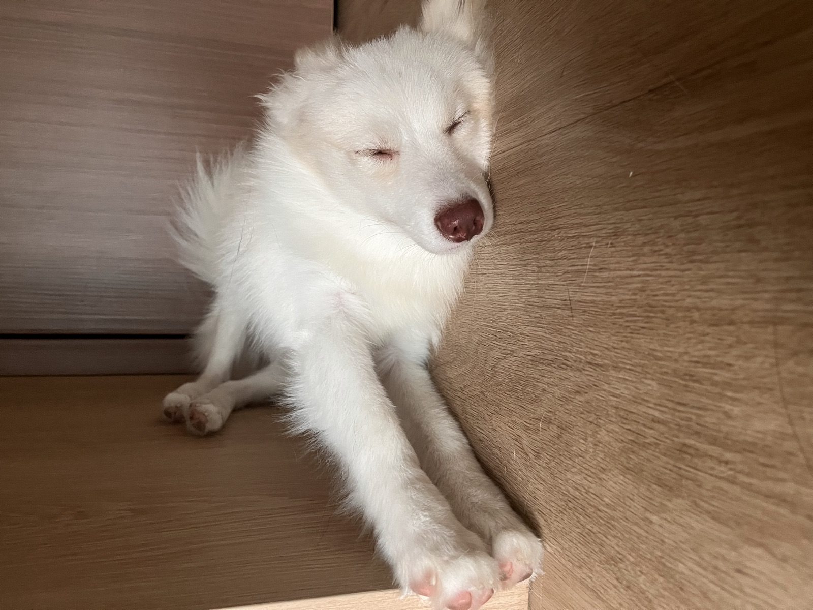
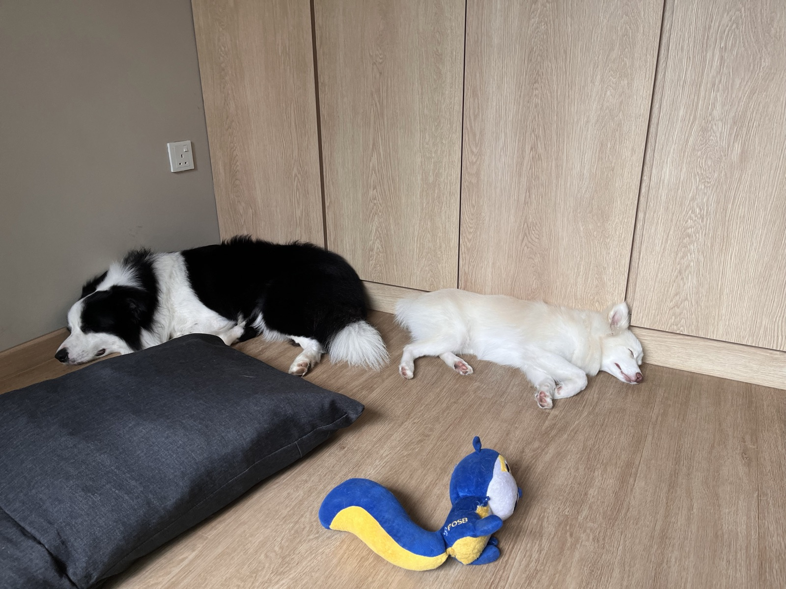

## 22 Oct

### 9:12am

<!-- entry-id: e118 -->

Two grandpas, one grandchild, and an official canine surveillance team.

### 7:15am

<!-- entry-id: e009 -->

Luffy is convinced Hugo's water tastes better, so he squeezes in to drink with him.

## 21 Oct

### 6:59pm

<!-- entry-id: e008 -->
<!-- no-time -->

Tiny's owner hilariously added, “Find yourself a man who looks at you the way Hugo looks at Tiny.”

### 6:22pm

<!-- entry-id: e007 -->
<!-- no-time -->

Meeting their neighbours, Rosie and Tiny. Hugo is once again fixated on a girl. This time, it’s Tiny.

### 4:20pm

<!-- entry-id: e006 -->

Gravity works sideways for Luffy.

### 1:41pm

<!-- entry-id: e005 -->
<!-- no-time -->

Brothers taking their afternoon nap

### 12:09pm

<!-- entry-id: e004 -->
<!-- no-time -->

Hugo is a manja king. He keeps asking me to sayang him.

### 8:10am

<!-- entry-id: e003 -->
<!-- no-time -->

This morning's play. Luffy baiting Hugo into chasing him.

## 20 Oct

### 9:15pm

<!-- entry-id: e002 -->
<!-- with: luna -->
<!-- no-time -->

Hugo found his calling. His self-appointed job is to hump Luna. Meanwhile, Luffy wants to play with her, so Luna has to juggle playing with Luffy and protecting herself from Hugo.

### 8:15pm

<!-- entry-id: e001 -->
<!-- with: luna -->

Welcome Hugo and Luffy!

