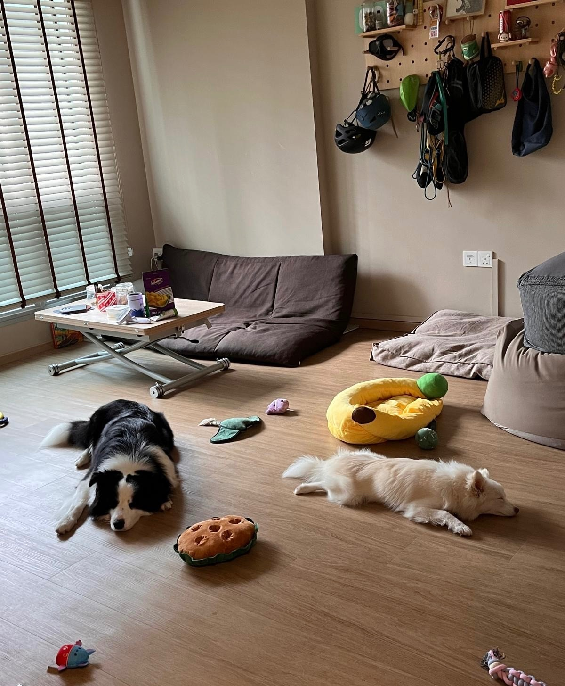
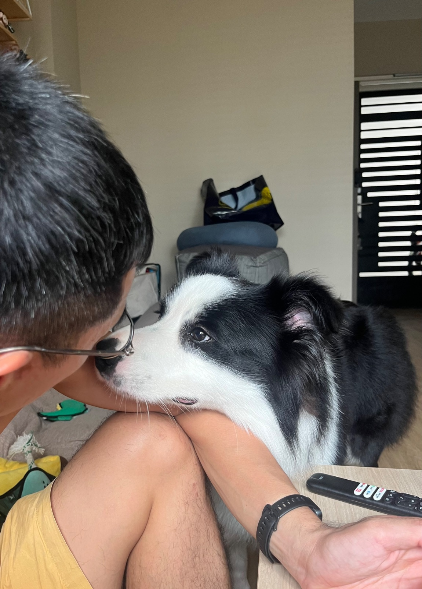
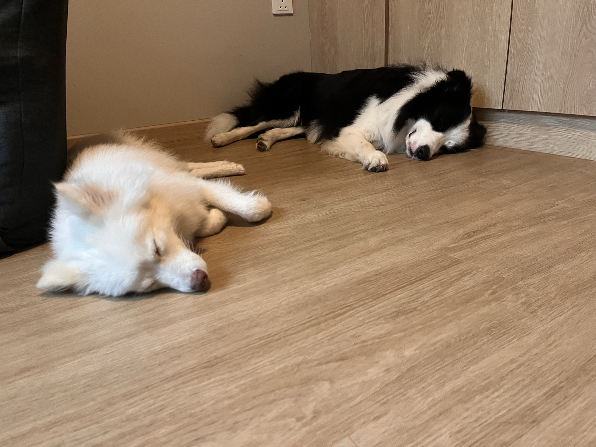
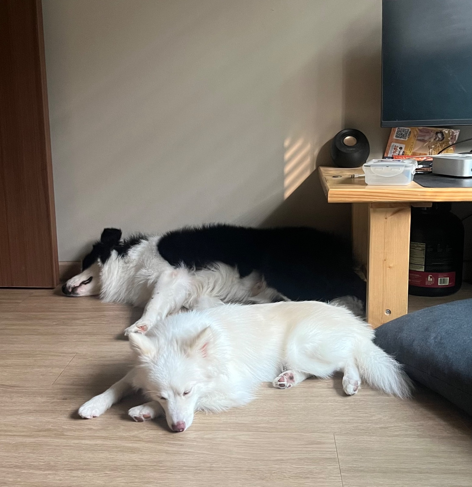
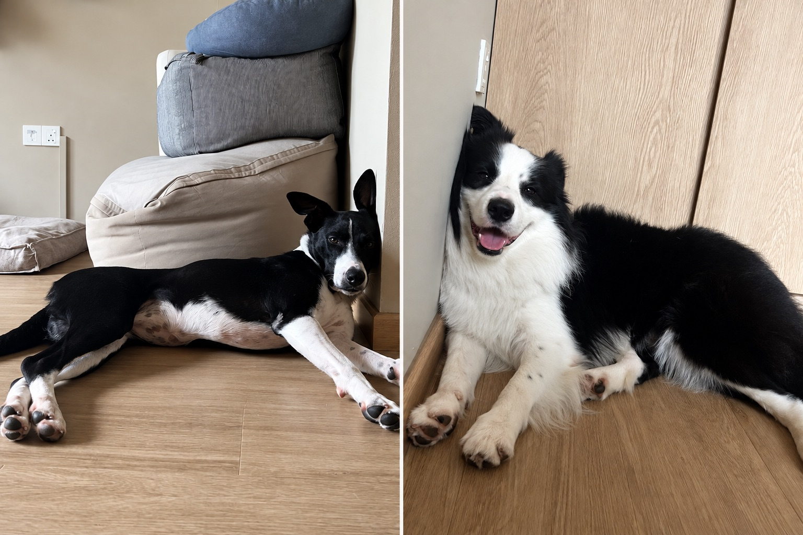
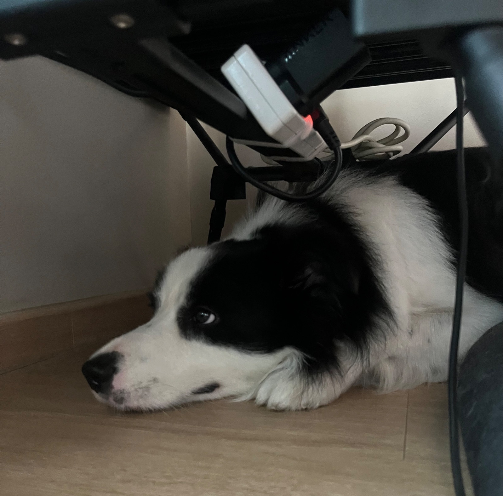

## 25 Oct

### 10:07am

<!-- entry-id: e136 -->

Round 2: KO after a fun-filled morning of smelling girls and chasing dogs. The brothers have clocked out.

### 7:40am

<!-- entry-id: e137 -->
<!-- no-time -->

Brought them to the temporary dog run near City Square.

## 24 Oct

### 11:03pm

<!-- entry-id: e135 -->
<!-- no-time -->

Hugo is stealing my husband

### 2:45pm

<!-- entry-id: e133 -->

The brothers are KO after a fun-filled morning.

### 10:45am

<!-- entry-id: e132 -->

Hugo having a play with Mocha, Marou’s half sister, while Luffy plays with Marou in the background.

### 8:35am

<!-- entry-id: e134 -->
<!-- no-time -->

Luffy, don’t be rude to Tiny.

### 8:30am

<!-- entry-id: e131 -->

And then it’s back to Tiny, our track and field champion. Hugo has a thing for sporty girls.

### 8:25am

<!-- entry-id: e130 -->

This morning Hugo briefly has a new obsession. Liesel, the beautiful black dachshund.

## 23 Oct

### 8:50pm

<!-- entry-id: e129 -->

Luffy loves our purple squeaky plushie so much that he’s trying to bury it. We’re dying from the cuteness.

### 6:45pm

<!-- entry-id: e128 -->

Luffy is bringing the ball back every time we throw it! He rarely does that. Maybe he learnt from Rosie. Now, Rosie, can you teach him to stop biting everything?

### 5pm

<!-- entry-id: e127 -->

Tired from asking for pats.

### 2:20pm

<!-- entry-id: e126 -->

Hugo came to Weiwen to hide from Luffy, but Luffy found him.

### 7:30am

<!-- entry-id: e125 -->

No one was at the carpark this morning but that doesn't stop the brothers entertaining themselves.

## 22 Oct

### 9:58pm

<!-- entry-id: e124 -->
<!-- no-time -->

Same same but different.

### 4:30pm

<!-- entry-id: e123 -->

Marou the Pomeranian, our next-door neighbour, came to visit. Luffy was having fun with him while Hugo wondered when he’d get to join in.

### 2:30pm

<!-- entry-id: e122 -->

Featuring Luffy's way of asking for pats

### 2:18pm

<!-- entry-id: e121 -->

Hugo’s refuge when Luffy’s idea of a break is to keep playing.

### 11:22am

<!-- entry-id: e120 -->

It's Weiwen's turn to be harassed by Hugo for pats.

### 10:15am

<!-- entry-id: e119 -->

"Kor kor wants it, so I must have it," Luffy thinks.

### 9:12am

<!-- entry-id: e118 -->

A grandpa, a grandma and a grandkid, under watch by an official canine surveillance team.

### 7:15am

<!-- entry-id: e009 -->

Luffy is convinced Hugo's water tastes better, so he squeezes in to drink with him.

## 21 Oct

### 6:59pm

<!-- entry-id: e008 -->
<!-- no-time -->

Tiny's owner hilariously added, “Find yourself a man who looks at you the way Hugo looks at Tiny.”

### 6:22pm

<!-- entry-id: e007 -->
<!-- no-time -->

Meeting their neighbours, Rosie and Tiny. Hugo is once again fixated on a girl. This time, it’s Tiny.

### 4:20pm

<!-- entry-id: e006 -->

Gravity works sideways for Luffy.

### 1:41pm

<!-- entry-id: e005 -->
<!-- no-time -->

Brothers taking their afternoon nap

### 12:09pm

<!-- entry-id: e004 -->
<!-- no-time -->

Hugo is a manja king. He keeps asking me to sayang him.

### 8:10am

<!-- entry-id: e003 -->
<!-- no-time -->

This morning's play. Luffy baiting Hugo into chasing him.

## 20 Oct

### 9:15pm

<!-- entry-id: e002 -->
<!-- with: luna -->
<!-- no-time -->

Hugo found his calling. His self-appointed job is to hump Luna. Meanwhile, Luffy wants to play with her, so Luna has to juggle playing with Luffy and protecting herself from Hugo.

### 8:15pm

<!-- entry-id: e001 -->
<!-- with: luna -->

Welcome Hugo and Luffy!

