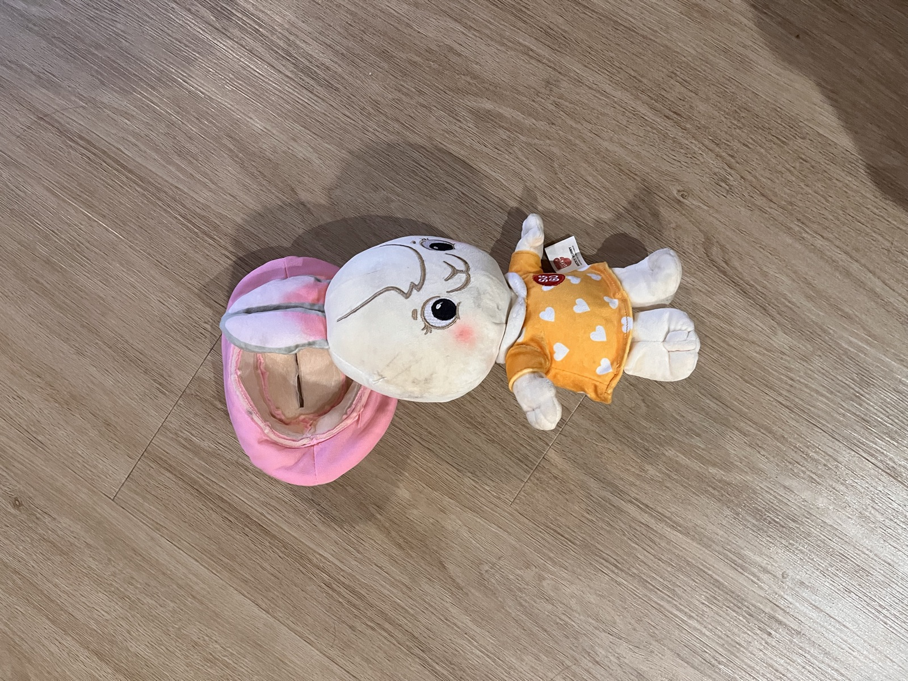
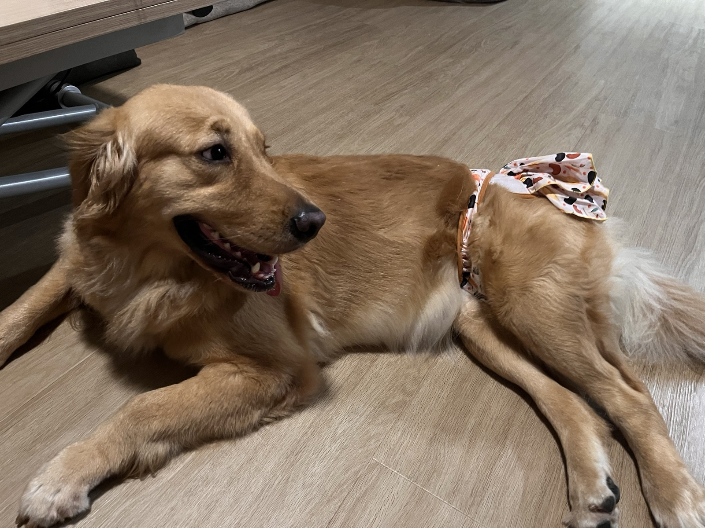

## 14 Oct

### 7:55am

<!-- entry-id: e004 -->

Luna pulled off this bunny plushie's hat within seconds. The same plushie Tiny played with so gently for many days.

### 7:20am

<!-- entry-id: e003 -->

<!-- with: tiny -->

Tiny is coming over later today. Luna didn't have to wait that long. We bumped into her at the carpark during our walk.

## 13 Oct

### 10:20pm

<!-- entry-id: e002 -->

Itsy bitsy skirt.

### 8:45pm

<!-- entry-id: e001 -->

Luna came charging in, cute skirt and all, and went straight for the blue squirrel plushies. So unladylike. When her owners left, she sang her usual symphony of whines.
