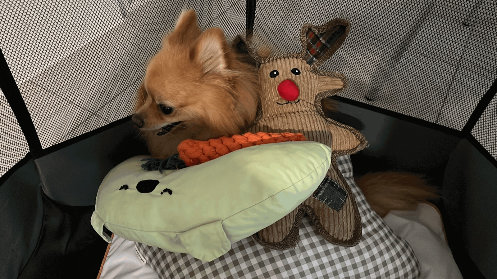

## 17 Nov

### 8:40am

<!-- entry-id: e240 -->

The loudest sound Marou has ever made while playing.

## 16 Nov

### 6:11pm

<!-- entry-id: e239 -->
<!-- no-time -->

The thunderstorm is easing, and Marou is getting slightly more active, weathering the storm one spot at a time.

### 6:04pm

<!-- entry-id: e238 -->
<!-- no-time -->

Marou is terrified of thunder, so Alan built him a plushie fortress to keep it out.

### 7:40am

<!-- entry-id: e237 -->

Good morning, Marou, the gentlest of souls.

