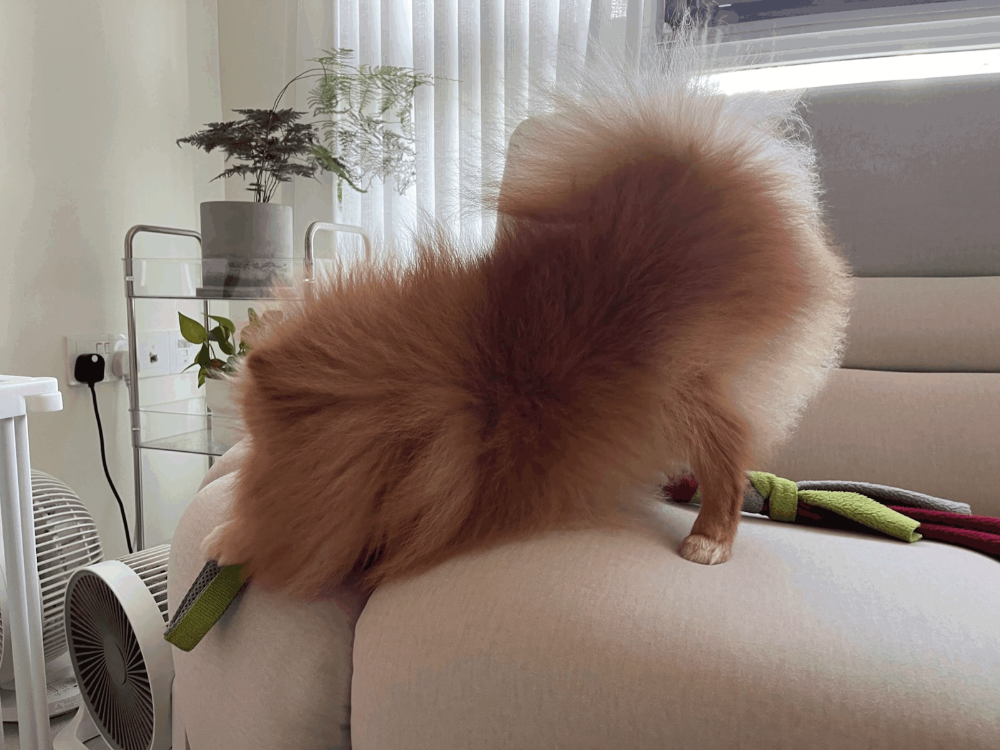
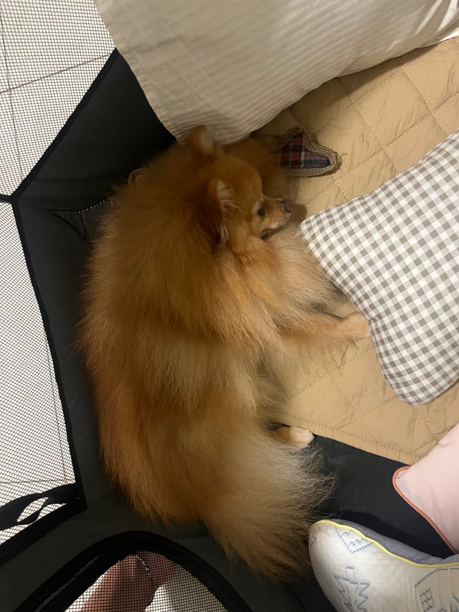
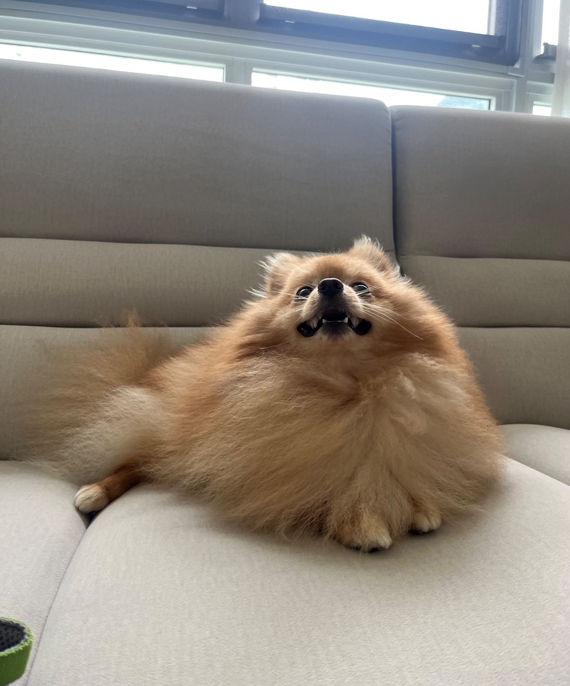
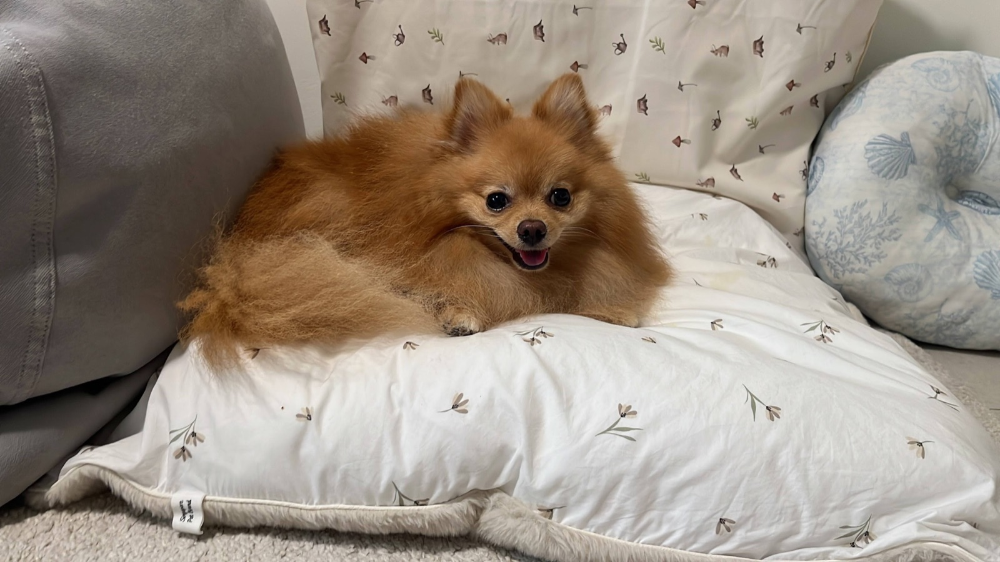

## 19 Nov

### 8:12am

<!-- entry-id: e248 -->
<!-- no-time -->

Marou baits Alan into reaching for the ball. As soon as Alan reaches for it, Marou blocks him and takes it himself.

### 8:06am

<!-- entry-id: e247 -->
<!-- no-time -->

Operation Slope. Marou went down belly first, commando style, and came out grinning.

## 18 Nov

### 1:19pm

<!-- entry-id: e246 -->
<!-- no-time -->

Found a feather duster on the sofa. It had legs.

### 1:14pm

<!-- entry-id: e245 -->
<!-- no-time -->

Marou taken aback when Alan copied his growling.

## 17 Nov

### 8:43pm

<!-- entry-id: e244 -->

The thunder passed. Marou went back to his snuffle toy, which had lasted since lunch. It had weathered the storm too.

### 7:40pm

<!-- entry-id: e243 -->

Thunder came, back to his safe place.

### 1:30pm

<!-- entry-id: e242 -->

Is the thunder coming back? Marou would like to know how long this storm is planning to stay.

### 9:40am

<!-- entry-id: e241 -->

Marou runs away and flips himself over whenever I want to put him back in the playpen.

### 8:40am

<!-- entry-id: e240 -->

The loudest sound Marou has ever made while playing.

## 16 Nov

### 6:11pm

<!-- entry-id: e239 -->
<!-- no-time -->

The thunderstorm is easing, and Marou is getting slightly more active, weathering the storm one spot at a time.

### 6:04pm

<!-- entry-id: e238 -->
<!-- no-time -->

Marou is terrified of thunder, so Alan built him a plushie fortress to keep it out.

### 7:40am

<!-- entry-id: e237 -->

Good morning, Marou, the gentlest of souls.

