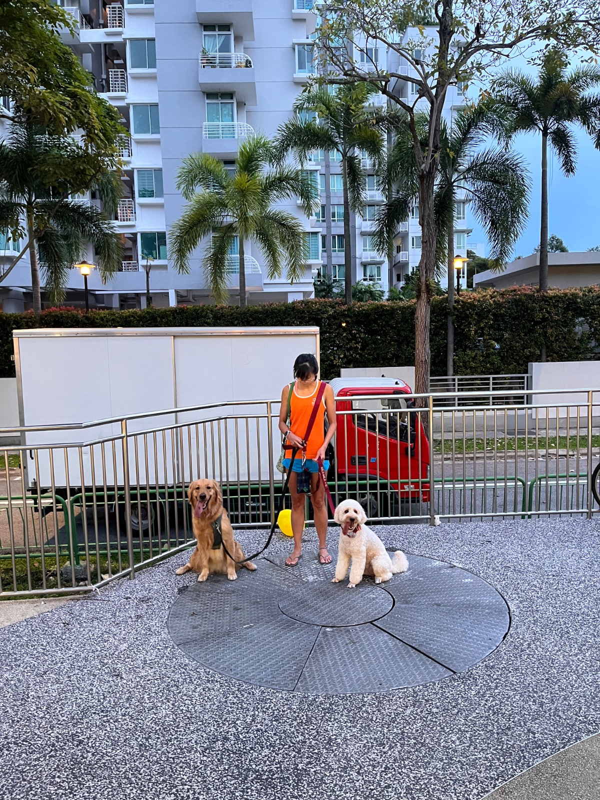
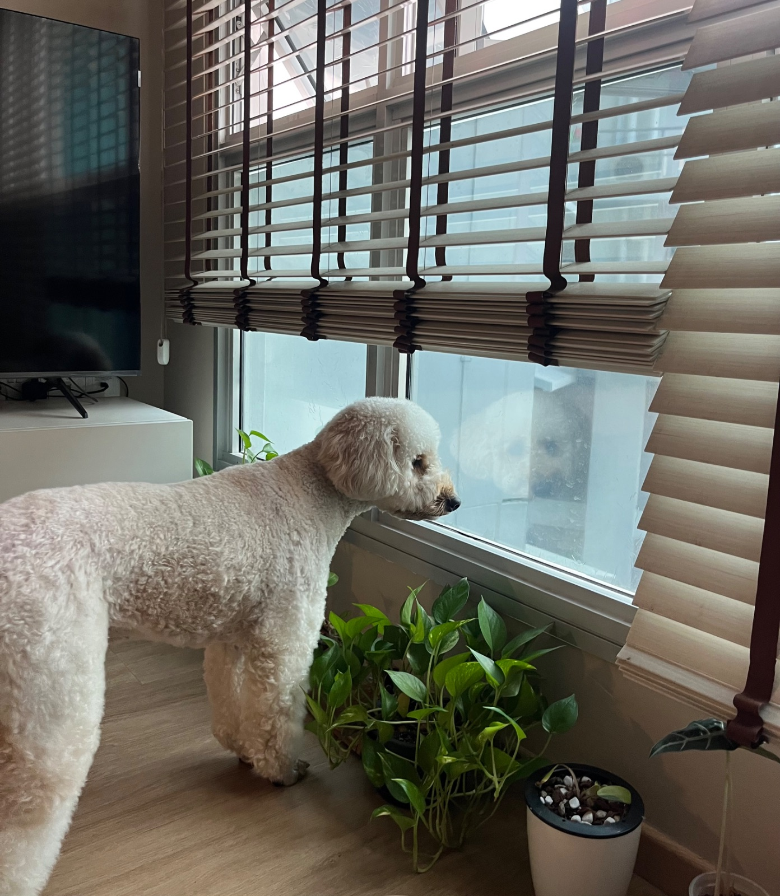

## 21 Nov

### 3:15pm

<!-- entry-id: e267 -->
<!-- with: luna -->

Milk kept whining, briefly convinced that jumping was a skill she had never learned.

### 2:38pm

<!-- entry-id: e266 -->
<!-- no-time -->

Milk failed the treat balancing act

### 8:22am

<!-- entry-id: e262 -->
<!-- with: luna -->
<!-- no-time -->

We brought them to Whampoa to buy our breakfast.

## 20 Nov

### 5:21pm

<!-- entry-id: e258 -->
<!-- no-time -->

Milk makes surprise inspections of the room, checking whether the hoomans have sneakily disappeared without her knowing.

### 2:22pm

<!-- entry-id: e256 -->

Milk can hold a long stay with food in sight, sometimes with drool. But can she hold a stay with food on her nose? Stay tuned.

### 12pm

<!-- entry-id: e255 -->

Reclaiming her toy.

### 9:27am

<!-- entry-id: e254 -->
<!-- no-time -->

Milk is keeping an eye on the kids downstairs.

## 19 Nov

### 7:45pm

<!-- entry-id: e250 -->

Milk helping herself to the toys.

### 7pm

<!-- entry-id: e251 -->

How many dogs are there?

### 6:15pm

<!-- entry-id: e253 -->

Peach and Milk are going after the same ball.

### 5:45pm

<!-- entry-id: e249 -->

Same same, but different.

### 3:39pm

<!-- entry-id: e005 -->
<!-- no-time -->

Milk finally steps up to fight the pink dragon. No more whining.

### 2:37pm

<!-- entry-id: e004 -->
<!-- no-time -->

Milk doing what she does best. Picking up leaves.

### 1:57pm

<!-- entry-id: e003 -->
<!-- no-time -->

Whining much less now.

### 1:41pm

<!-- entry-id: e002 -->
<!-- no-time -->

Milk is too busy whining to eat her meal, so Alan ends up hand-feeding her as she whines. Whined and dined.

### 11:01am

<!-- entry-id: e001 -->
<!-- no-time -->

Poor Milk is whining after her owners left. 😢

