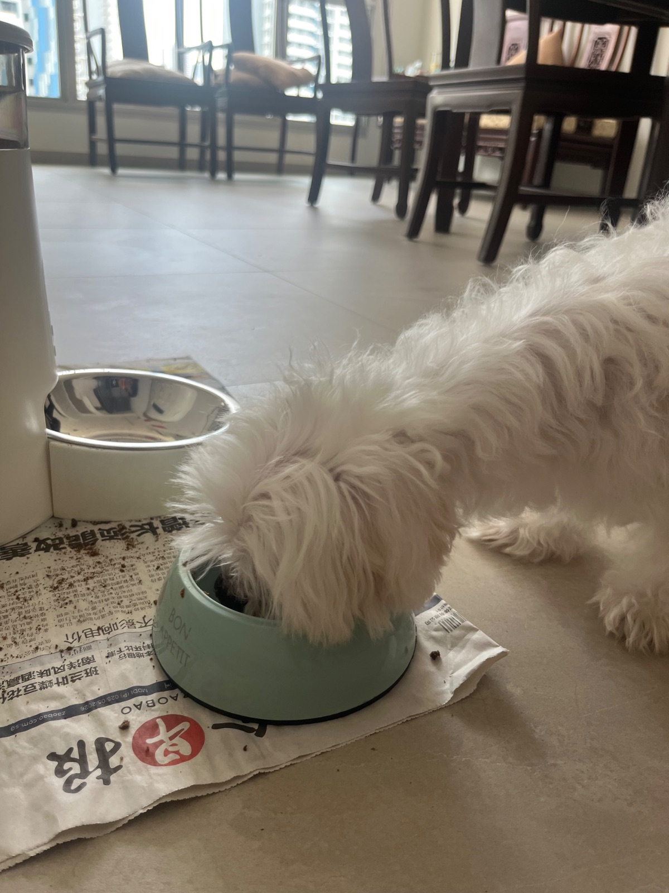
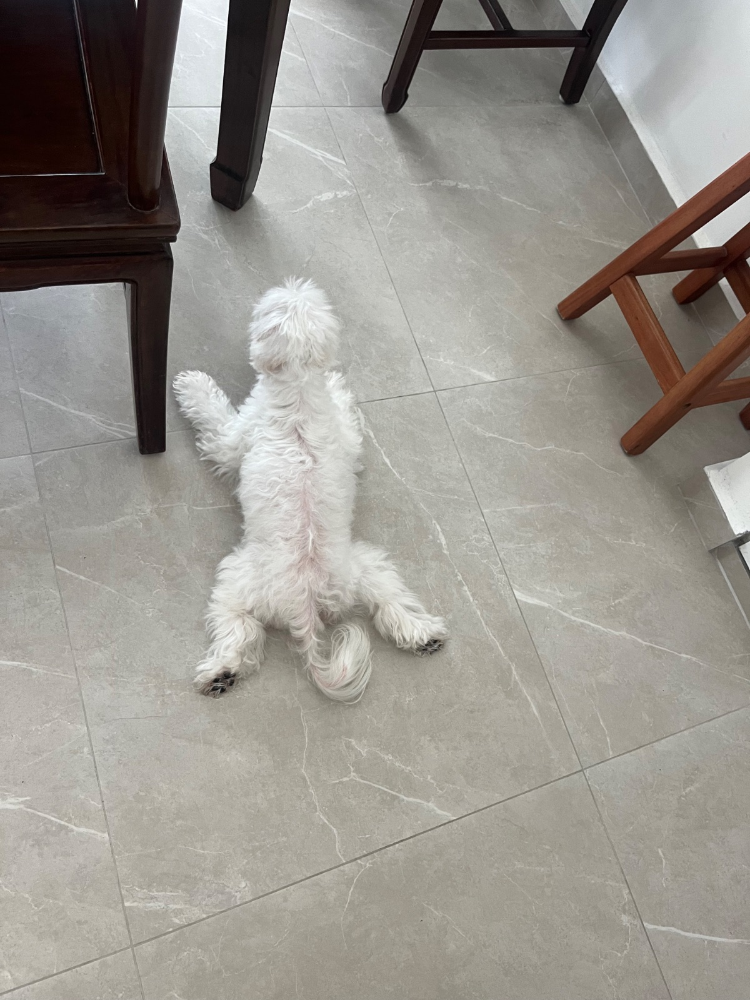
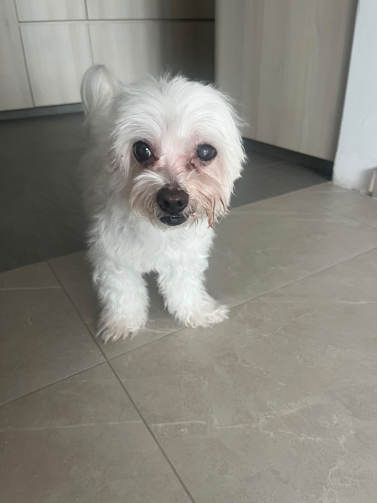

## 10 Nov

### 1pm

<!-- entry-id: e206 -->

Burying his head in his meal.

### 9:44am

<!-- entry-id: e204 -->
<!-- no-time -->

Riot’s bowel system waits until no one is around to start. Then this clean fella navigates his obstacle course.

## 6 Nov

### 4:02pm

<!-- entry-id: e180 -->
<!-- no-time -->

Riot gobbled down his food while keeping one eye on me.

### 11:53am

<!-- entry-id: e174 -->

Sleeping away from the obstacle course he left around the house.

## 5 Nov

### 3:43pm

<!-- entry-id: e173 -->
<!-- no-time -->

Riot looking proud to have pooped so many times today.

### 2:22pm

<!-- entry-id: e172 -->
<!-- no-time -->

Someone's feeling manja today.

### 8:33am

<!-- entry-id: e171 -->
<!-- no-time -->

Riot walks nicely unleashed. He gets to mark whenever he likes, but he still follows you well.

